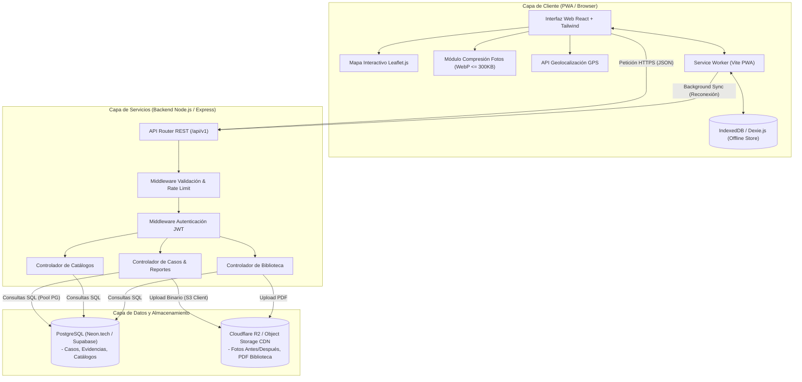
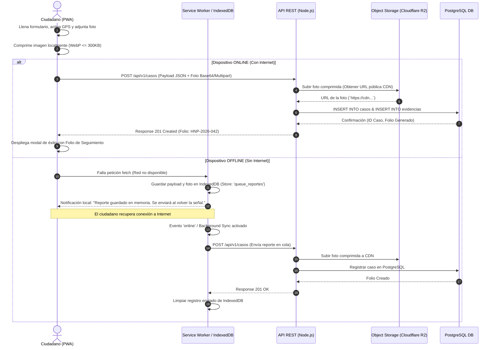
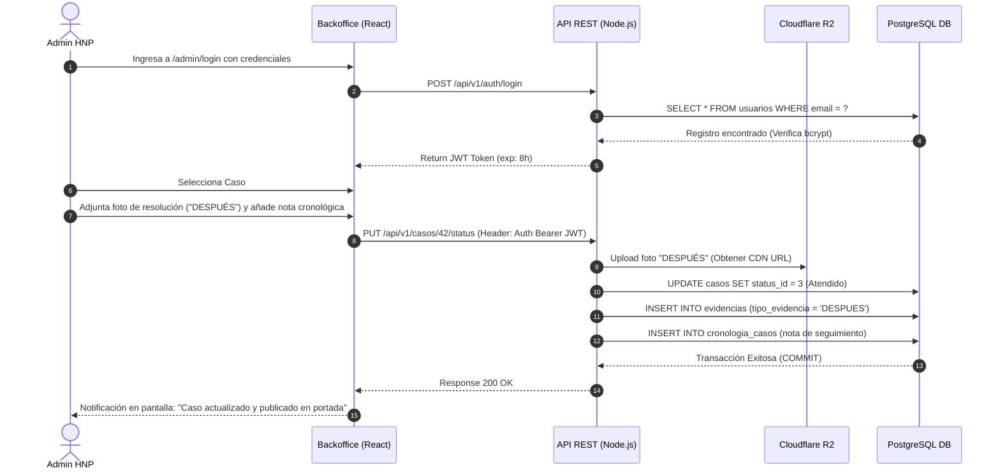

# DIAGRAMA GENERAL DEL SISTEMA Y FLUJOS DE DATOS

**Plataforma Web:** Radar Ciudadano HNP – Archivo Digital y Observatorio Comunitario

**Proyecto:** Hechos No Palabras (HNP) – Cunduacán, Tabasco

**Unidad Receptora:** ALLS BASIC SUPPLY COMPANY SA DE CV

**Estudiante / Desarrollador:** Yesenia Sarai Martínez Collado

**Responsable del Proyecto:** Alexis Miguel Lazo Fuentes

**Fase de Desarrollo:** Fase 1 – Análisis y Planeación del Proyecto (Semanas 1 y 2)

**Versión del Documento:** 1.0

---

## 1. DIAGRAMA GLOBAL DE ARQUITECTURA DEL SISTEMA

El siguiente diagrama detalla la interacción entre todos los componentes técnicos del ecosistema **Radar Ciudadano HNP**, desde la interfaz cliente PWA hasta el almacenamiento persistente en base de datos y la nube.

---

## 2. DIAGRAMAS DE SECUENCIA DE PROCESOS CLAVE

### 2.1 Secuencia A: Envío de Reporte Ciudadano (Conexión Online vs Sincronización Offline)

### 2.2 Secuencia B: Moderación Administrativa y Carga de Foto "DESPUÉS"

---

## 3. MAPEO DE ENDPOINTS DE LA API REST (ESPECIFICACIÓN API v1)

El backend expone las siguientes rutas estructuradas que alimentan al cliente React PWA:

### 3.1 Módulo de Autenticación (`/api/v1/auth`)

* `POST /api/v1/auth/login`: Autentica un administrador y retorna el Token JWT.
* `GET /api/v1/auth/me`: Valida el estado de la sesión del token actual.

### 3.2 Módulo de Casos y Reportes (`/api/v1/casos`)

* `GET /api/v1/casos`: Obtiene lista paginada de casos con filtros por categoría, status y Centro Integrador (Público).
* `GET /api/v1/casos/:folio`: Obtiene el expediente detallado de un caso por su Folio Único (Público).
* `POST /api/v1/casos`: Registra un nuevo reporte ciudadano desde la PWA (Público / Anonimizado).
* `PUT /api/v1/casos/:id/status`: Actualiza estado del caso y adjunta fotos "Antes/Después" (Privado / Reclama JWT).
* `POST /api/v1/casos/:id/cronologia`: Agrega una nueva nota de avance a la línea de tiempo del expediente (Privado / JWT).

### 3.3 Módulo de Catálogos (`/api/v1/catalogos`)

* `GET /api/v1/catalogos/categorias`: Devuelve la lista de categorías (Baches, Luminarias, Drenaje, etc.) con sus colores e iconos para Leaflet.js.
* `GET /api/v1/catalogos/centros-integradores`: Devuelve la lista de Centros Integradores y sus localidades asociadas en Cunduacán.
* `POST /api/v1/catalogos/:tipo`: Crea un nuevo elemento en catálogo (Privado / JWT).

### 3.4 Módulo de Biblioteca Ciudadana (`/api/v1/biblioteca`)

* `GET /api/v1/biblioteca`: Devuelve lista de publicaciones y documentos PDF disponibles (Público).
* `POST /api/v1/biblioteca`: Sube un nuevo documento PDF con su miniatura al almacenamiento R2 (Privado / JWT).
* `DELETE /api/v1/biblioteca/:id`: Elimina un documento de la biblioteca (Privado / JWT).

---

## 4. MATRIZ DE RESILIENCIA Y MANEJO DE ERRORES

| Nivel de Falla | Causa Probable | Mecanismo de Tolerancia a Fallas |
| --- | --- | --- |
| **Pérdida Total de Red** | Falta de cobertura 4G/5G en comunidades rurales. | **IndexedDB + Service Worker:** Captura el reporte localmente, mantiene las fotos comprimidas en almacenamiento local y reintenta el envío al reconectar. |
| **Falla en Carga de Mapa** | Bloqueo o lentitud en servidores OpenStreetMap. | **Fallback de Visualización:** Si las baldosas (*tiles*) del mapa no cargan, la vista conmuta suavemente a la presentación en catálogo de lista sin bloquear la interfaz. |
| **Fotografías Masivas / Pesadas** | Usuarios intentando subir imágenes de 10 MP a 20 MP. | **Compresión HTML5 Canvas Client-Side:** Antes de tocar la red o IndexedDB, se escala y comprime la foto a formato WebP ajustando el peso a $\le 300\text{ KB}$. |
| **Interrupción de Base de Datos** | Mantenimiento puntual en Neon/Supabase. | **Caching en CDN / SW Cache:** El frontend sirve el estado estático en caché de los últimos casos consultados para mantener la lectura activa. |

---

## 5. CONCLUSIÓN Y CIERRE DE LA FASE 1

Con la elaboración de este documento, en conjunto con los tres entregables previos:
1. `docs/01_SRS_Requerimientos.md` (Documento SRS)
2. `docs/02_Arquitectura_y_Stack.md` (Arquitectura & Costos)
3. `docs/03_Mapa_del_Sitio.md` (Sitemap & Enrutamiento React)
4. `docs/04_Diagrama_General_Sistema.md` (Diagramas & API Endpoints)

Se da por **completada al 100% la Fase 1: Análisis y Planeación del Proyecto (Semanas 1 y 2)**.

* **Elaborado por:** Yesenia Sarai Martínez Collado (Estudiante de Ingeniería en Sistemas Computacionales - UJAT)
* **Revisado por:** Alexis Miguel Lazo Fuentes (Responsable de Proyecto - ALLS BASIC SUPPLY COMPANY SA DE CV)